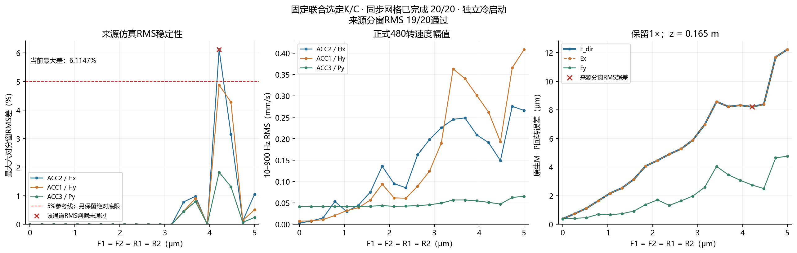
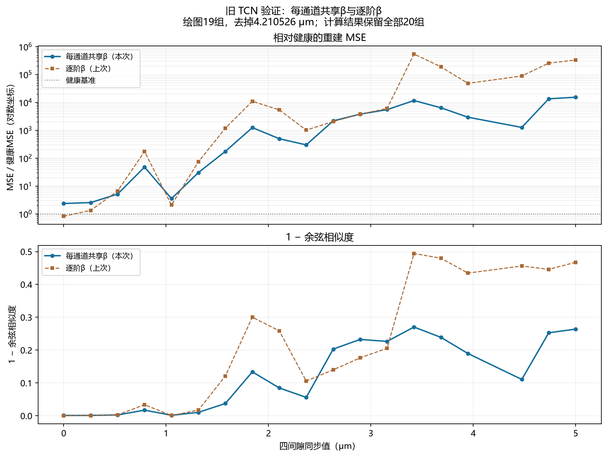

# 20自由度同步间隙实验｜2026-10-28

这里保留从现有实验中挑选的参数、报告、图片和动画。原始或逐窗波形、原生状态、真实健康采集数据、TCN训练数据和临时脚本均未提交。图像和视频是已有结果的可视化，不是原始数据。

## 数据生成与回转误差

固定 c07 参数，F1=F2=R1=R2 在0–5 μm内等距取20级，另有精确1 μm健康对照。实际生效参数见 [c07 配置](../../../config/model20_sync20_c07_20261028.json)；默认 [model20.json](../../../config/model20.json) 是此前 c24，不能混用。c07配置按运行时原样保存，其中历史的额外判定字段不作为当前验收门槛。

来源仿真的四窗速度RMS按当前口径19/20通过；4.210526 μm的Hx最大差6.1147%。回转误差是模型在 z=0.165 m 处 M 相对 P 的原生位移统计，不是实机几何精度。

3.421053 μm的[健康/合成对比](figures/level_13_health_synthesis.png)和[输入/TCN重建对比](figures/level_13_reconstruction.png)。

## 通道共享 β 和 TCN

每通道将1×–7×幅值均方根的实测/1 μm仿真之比作为共享 β，三个通道分别为0.7144、0.6545、1.3583。使用同一个健康背景和已保存TCN权重计算20级80窗；下面的图按先前要求仅排除4.210526 μm。上一轮为逐阶β、18/21组分，本轮为共享β、21/21组分，所以差异包含两个变化。

[完整结果和20级汇总](shared_beta_report.md) · [余弦相似度图](figures/mse_log_cosine.png) · [共享β参数](shared_beta.json)

## 频率敏感性和动画

在不重新积分的情况下，将原生速度用于10–2048 Hz频率分析；1×–7×不能覆盖所有间隙相关变化。非整数谱的定义是剔除1–17×各±2 Hz后的剩余频谱，包含泄漏和边带，不能直接等同独立异步振源或认定分岔。

[频率－间隙图](figures/frequency_gap_heatmaps.png) · [非整数频段](figures/noninteger_broad_bands.png) · [能量密度－间隙图](figures/density_gap_heatmap.png)

按间隙排列：[全频动画 GIF](media/full_0_to_5um.gif) / [视频 MP4](media/full_0_to_5um.mp4)；[非整数频段 GIF](media/noninteger_0_to_5um.gif) / [视频 MP4](media/noninteger_0_to_5um.mp4)。

按模型 E_dir 排列：[全频动画 GIF](media/full_by_runout.gif) / [视频 MP4](media/full_by_runout.mp4)；[非整数频段 GIF](media/noninteger_by_runout.gif) / [视频 MP4](media/noninteger_by_runout.mp4)。动画保留原20级，顺序不代表间隙和回转误差单调对应。

模型结果基于有限数据和单一健康背景；没有实机微米级精度真值校准，也不将TCN分数解释为精度预测。
